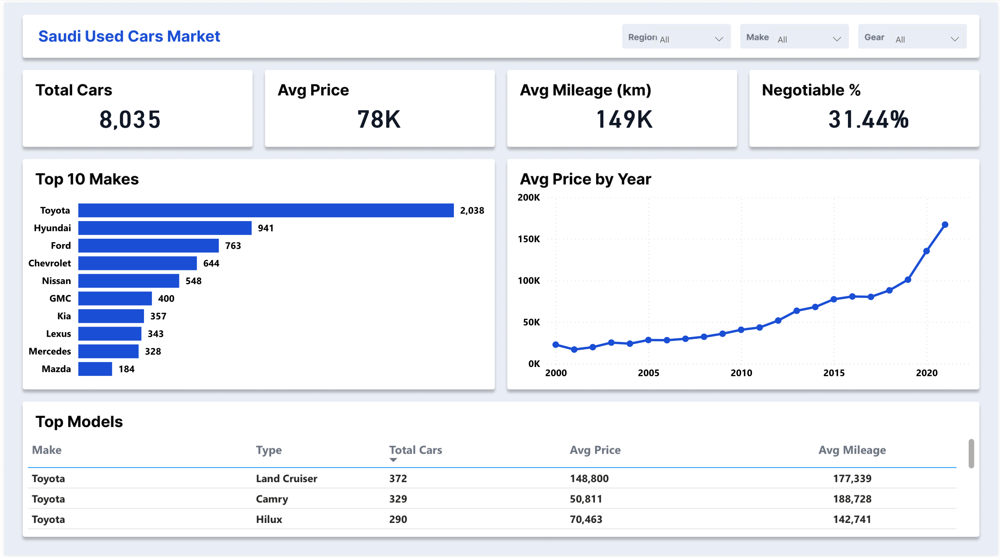

# 🚗 Saudi Used Cars Market – Power BI Dashboard

An interactive Power BI dashboard analyzing **8,035 used car listings in Saudi Arabia**, designed in **Figma** and built in **Power BI**.

---

## 📌 Business Question

**What drives used car prices in Saudi Arabia, and where is the market concentrated?**

Sub-questions:
1. Which car makes and models are listed the most?
2. How does a car's manufacturing year affect its price?
3. What share of listings have no fixed price (negotiable)?

---

## 🗂️ Dataset

Saudi Arabia Used Cars dataset from Kaggle.

---

## 🛠️ Tools

| Tool | Used for |
|---|---|
| **Figma** | Dashboard layout and background design |
| **Power BI** | Data modeling, DAX measures, visuals |
| **Power Query** | Data cleaning and type checks |

---

## 🔄 Process

1. **Design:** Designed the dashboard layout in Figma and used it as the Power BI background.
2. **Cleaning:** Listings with Price = 0 are negotiable, so they were kept in the total but **excluded from the average price** to avoid misleading results.
3. **Analysis:** Built DAX measures for the KPIs and added slicers for Region, Make and Gear Type.

---

## 💡 Key Insights

| KPI | Value |
|---|---|
| Total listings | 8,035 |
| Average price | ~78K SAR |
| Average mileage | ~149K km |
| Negotiable listings | 31.4% |

1. **Toyota dominates the market** with 2,038 listings, about **25%** of all cars, followed by Hyundai (941) and Ford (763).
2. **Newer cars are priced much higher.** Average price rises slowly until about 2015, then climbs sharply for 2018+ models, showing that cars lose most of their value in their first years.
3. **Nearly 1 in 3 listings has no fixed price**, which is why handling zero prices correctly was important for an accurate average.
4. **Land Cruiser is the most listed model** (372 listings) with the highest average price among top models (~149K SAR), while Camry is the second most listed at a much lower price (~51K SAR).

---

## 📁 Files

| File | Description |
|---|---|
| `saudi cars.pbix` | Power BI report file |
| `dashboard.png` | Dashboard screenshot |
| `README.md` | Project documentation |

---

## 👩‍💻 Author

**Hour Aljubayri** – Data Analyst
GitHub: [Hour477](https://github.com/Hour477)
